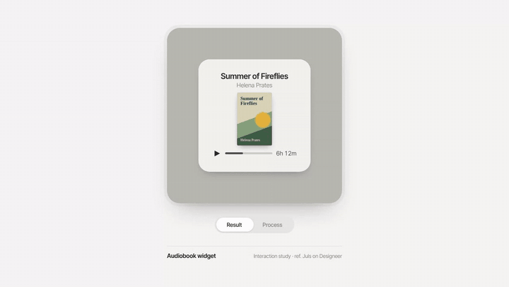

<div align="center">

# designeer-mcp

**The [Designeer](https://designeer.xyz) catalog, right inside Claude.**
Search references, pull palettes as hex, watch motion frame by frame and copy components as HTML + CSS without leaving the chat.

[](https://modelcontextprotocol.io)
[](https://nodejs.org)
[](LICENSE)

</div>

---

Designeer is Dhruv Jaradi's curated catalog of inspiration galleries, components, fonts, tools, portfolios and **finds**: motion and interface work picked from X. This MCP server turns all of it into tools that Claude (or any MCP client) calls on its own.

It only uses what the site's [`ai.txt`](https://designeer.xyz/ai.txt) allows for AI: `/api/catalog`, the `.md` pages and static files. It never touches bookmarks, folders or login.

## Examples

Paste a Designeer link into Claude Code (or Claude Desktop) and ask in plain language, in any language. Claude picks the tools by itself.

### Rebuild a screen from a find

**Prompt**

```text
try to build this screen https://designeer.xyz/finds/designedforfun-2108922344152428589
```

**What Claude did**

1. `designeer_get` found that it's a motion piece by **Juls ([@designedforfun](https://x.com/designedforfun))**: an audiobook widget that switches between the final design and the rough draft.
2. `designeer_media` with `frames: 4` showed the sequence, so Claude could work out the interaction: the card spins on the Y axis, swaps content halfway through the turn, and the frame changes color.
3. Claude wrote a page with the same mechanic, using made-up books, authors and covers.

<table>
  <tr>
    <th width="50%">Inspiration</th>
    <th width="50%">Result</th>
  </tr>
  <tr>
    <td align="center">
      <video src="https://github.com/user-attachments/assets/eca822fd-1dc0-45a5-a175-c23488e0aa41" width="400"></video><br>
      <a href="https://x.com/designedforfun/status/2108922344152428589">Original post on X</a>
    </td>
    <td align="center"></td>
  </tr>
</table>

Run it yourself: open [`examples/widget-flip/index.html`](examples/widget-flip/index.html) in a browser and click **Result / Process**. There's also an [MP4](examples/widget-flip/demo.mp4) and still frames of each state ([Result](examples/widget-flip/result.png), [Process](examples/widget-flip/process.png)).

### Understand a find

**Prompt**

```text
what is this? https://designeer.xyz/finds/andreaskruszaki-2115308820687950002
```

**Result:** Claude explains that it's a 3D animation of a matcha sachet that falls, tears open, bursts into powder and reveals the closing line, and hands back what `designeer_get` returned:

```jsonc
{
  "title": "Motion by Andreas Kruszakin-Liboska: it's just…",
  "summary": "it's just matcha...",
  "fields": {
    "handle": "@andreaskruszaki",
    "types": "Motion",
    "posted": "2026-10-28"
  },
  "colours": ["#E9EDEA", "#02541C", "#177A35", "#379953", "#6C8A75"],
  "related": [ /* 8 similar finds */ ]
}
```

With `frames: 4`, the video's still and the motion sequence come along as images, so Claude actually **sees** the animation and can explain or rebuild the technique.

### More prompts to try

```text
find me 5 dark dashboard references on designeer
```

```text
which fonts does designeer list for a fintech landing page?
```

```text
take the palette from this find and turn it into CSS tokens for my project:
https://designeer.xyz/finds/<find-slug>
```

```text
open the Linear website and give me the pricing card as HTML + CSS
```

```text
show me this week's motion finds and summarize the technique behind each one
```

> **Tip:** when rebuilding something, ask for the **technique** with your own content. The mechanics of an animation are free to study; the author's covers, logos, branding and copy are not.

## Tools

| Tool | What it does |
|---|---|
| `designeer_search` | Searches the whole catalog, with an optional collection filter |
| `designeer_browse` | Lists a collection in curated order, with category and pagination |
| `designeer_get` | Details for a listing or find: website, category, pricing, **hex palette**, creator, original post, related items |
| `designeer_finds` | Latest finds, with a text filter |
| `designeer_media` | High-res images and video stills, returned for Claude to **see**. With `frames > 0` + ffmpeg, extracts motion frames |
| `designeer_capture` | Opens **any URL** in your Chrome/Edge, takes a full-page screenshot and reads how it's built: colors, fonts, type scale, radii, shadows, CSS vars, sections, grids, and the recipe for buttons, cards, inputs and badges |
| `designeer_component` | **Copies a component or section as code**: clean HTML + CSS, a screenshot of the original and a standalone `.html` preview. Finds it by selector or by text + kind (`text: "Pro", kind: "card"`) |
| `designeer_status` | Tells whether it's running live or offline and how many items the index holds |

**Nothing is saved by default.** Screenshots and images go straight to Claude. Videos, which ffmpeg needs as files, go to a temp folder that's deleted afterwards. To keep them, ask with `save: true`, which saves to `~/designeer-media`.

## Install

Requires **Node 18+** and **Chrome or Edge** (for `designeer_capture`). ffmpeg is optional, only for extracting motion frames.

```bash
git clone https://github.com/G4rutti/designeer-mcp.git
cd designeer-mcp
npm install
npm run check   # tests everything and tells you if it's live or offline
```

### Claude Code

```bash
claude mcp add designeer --scope user -- node "/path/to/designeer-mcp/src/server.js"
```

### Claude Desktop

In `claude_desktop_config.json` (Settings → Developer → Edit Config):

```json
{
  "mcpServers": {
    "designeer": {
      "command": "node",
      "args": ["/path/to/designeer-mcp/src/server.js"]
    }
  }
}
```

On Windows, use `/` or `\\` in the path. Restart the app after saving.

### Optional environment variables

| Variable | Purpose |
|---|---|
| `DESIGNEER_OFFLINE=1` | Forces offline mode |
| `DESIGNEER_CACHE_DIR` | Changes the index cache folder |
| `DESIGNEER_MEDIA_DIR` | Changes where screenshots and media are saved (default `~/designeer-media`) |
| `DESIGNEER_UA` | Overrides the User-Agent |

## Live vs. offline

The site sits behind Cloudflare, and its dynamic endpoints (API and `.md`) challenge datacenter and VPN IPs. So the server has two modes:

- **live**: full API + markdown. This is what you get on a home connection.
- **offline**: when Cloudflare blocks, it falls back on its own to an index built from `sitemap.xml` + `llms-full.txt`, which are static and always pass. It has every URL and find, but names and taglines for only some of them, and no palettes or websites. It's cached in `~/.cache/designeer-mcp` for 12h.

Media comes from `cdn.designeer.xyz`, which has no challenge. `designeer_media` works on finds even offline; on listings it needs live mode.

## From reference to code

Designeer doesn't store a site's design, it **points** to it. The flow that works for motion, static shots and product screens:

1. **Find**: `designeer_search "dashboard"`, `designeer_browse inspiration` or `designeer_finds`
2. **Read**: `designeer_get` returns the official website and the hex palette
3. **See**: `designeer_media` for finds (with `frames: 4` on motion), `designeer_capture` for a site or a specific screen
4. **Copy**: `capture` lists components with selectors; pass one to `designeer_component` and get HTML + CSS back

What the copy doesn't capture: `:hover`/`:focus`, animations and `::before`/`::after`. Treat it as a starting point: swap colors and fonts for your project's tokens, and don't reuse the author's logo, images or copy. Pages behind a login (a signed-in Mobbin, for example) don't work.

## Attribution

The work belongs to the people who made it. Every response carries the `ai.txt` reminder: cite Designeer with a link to the canonical page and credit the creator as the page names them. Use it as a **reference**, not a copy.

## License

[MIT](LICENSE) © 2026 Davi Garutti Diniz. An independent project, not affiliated with Designeer.
